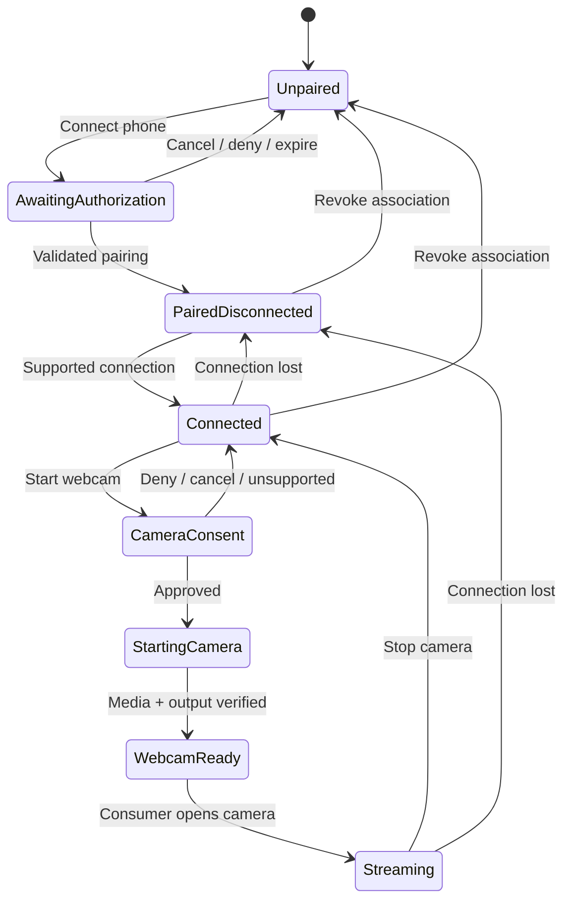

# Proposed flow — conditional on compatibility evidence

This is intended product behavior, not a recovered Microsoft protocol or an implemented UI. The pairing method, authentication flow, protocol fields, and camera transport have not been validated.

## 1. Readiness

1. User opens SapkaLink on Linux and chooses **Connect phone**.
2. Client explains that the phone uses its existing Link to Windows integration and checks the supported version/capability matrix once research establishes it.
3. If independent-client authorization or the phone version is unsupported, stop with a concrete explanation. Do not offer a different phone companion as if it met the requirement.

## 2. Authorize and pair

1. Start the legitimately supported user sign-in/consent and pairing process found by research. Whether this uses a browser, QR code, account device ring, local discovery, or a combination is unresolved.
2. Present the intended phone/client association clearly. User approves it through the existing phone stack.
3. Display a bounded pending state while approval is in progress. Cancellation, expiry, network loss, denial, and account mismatch lead to distinct recoverable states. Exact expiry and retry rules come from evidence, not invented constants.
4. Only validated association success becomes **Paired**. Connectivity is shown separately as Connected/Disconnected.
5. Reconnect reuses a supported authorization mechanism. A retry must not create duplicate device associations. With several phones, retain an explicit device selection and never silently switch the camera source.

Normal user sign-in belongs to the future product flow. Copying tokens or credentials from Microsoft's Windows app is excluded. Future secret storage must follow a separately reviewed Linux secure-storage policy; this repository contains no secrets.

## 3. Connect the phone

1. Open the supported communication path for the selected paired phone.
2. Show connection progress, offline/unreachable state, and any action genuinely required on the phone.
3. Treat a paired-but-offline phone as disconnected, rather than unpaired. Support retry and explicit unpair/revoke as distinct operations.
4. Discover camera capability separately from basic connection. A successful general connection must not be displayed as proof of camera support.

## 4. Start the connected-camera session

1. User chooses **Use phone as webcam** for the selected connected phone.
2. Request only the supported video capability, using the existing Microsoft phone stack. Request or explain phone-side camera consent through its legitimate mechanism.
3. Show **Waiting for permission**, **Starting camera**, or an actionable unsupported/denied/busy state. Do not capture microphone audio as an incidental default.
4. Negotiate the actual camera/media capabilities established by research. Front/rear selection, rotation, formats, resolution, and frame rate are offered only when supported by observed capabilities.
5. Publish a named virtual webcam through the chosen Linux mechanism. Mark it ready only when an independent consumer can open it successfully; preview alone is insufficient.
6. User selects the camera in another application. Demonstrate real live phone-camera frames in the acceptance applications and record the exact versions and source identity without publishing personal media.

## 5. Interrupt, recover, and stop

- Phone permission revocation or user stop ends capture promptly. The other application must not be led to believe frozen frames are a live feed.
- Connection loss changes the camera state clearly. Reconnection must respect consent and device selection; it must not switch to another phone.
- Camera contention, unsupported media format, Linux device permissions, absent virtual-device support, and consumer incompatibility have separate diagnostics.
- Stop releases the camera session and output resources. Whether a persistent but idle webcam device remains is an open UX/output decision.
- Unpair/revoke ends the association and relevant sessions. Final storage cleanup and revocation behavior require an explicit contract.

## Planning state model

These conceptual states guide research and acceptance. They do not prescribe implementation architecture or claim Microsoft uses these state names.
